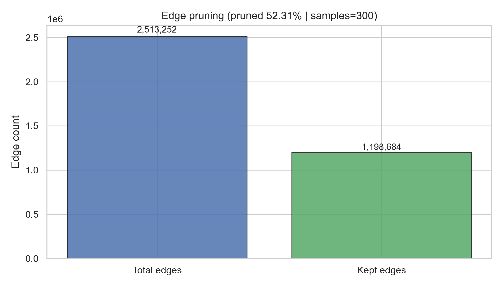

# A Relevance-Aware, Multimodal Framework for Efficient Trajectory Prediction in Dense Urban Environments

  

## Overview

This repository contains the implementation and experimental results for our research paper:

**"A Relevance-Aware, Multimodal Framework for Efficient Trajectory Prediction in Dense Urban Environments"**

The project introduces a lightweight and efficient trajectory prediction framework for autonomous driving systems operating in noisy and densely populated urban environments. Instead of relying on computationally expensive fully connected interaction graphs, our method applies a deterministic relevance-aware pruning strategy to remove non-impactful agents while preserving prediction accuracy.

The framework combines:

- Kalman-smoothed Constant Velocity (CV) trajectory estimation
- Relevance-aware graph pruning
- Multimodal interaction filtering
- Lightweight trajectory forecasting pipeline

Our experiments on the **nuScenes v1.0-mini** dataset demonstrate that over **52.31%** of interaction graph edges can be removed without degrading prediction quality.

---

# Key Features

- Relevance-aware interaction pruning
- Lightweight graph reduction framework
- Kalman filter-based motion smoothing
- Realistic noisy perception approximation
- Efficient trajectory prediction pipeline
- Compatible with existing predictors:
  - Trajectron++
  - EWTA
  - Contrastive Trajectron
  - HiVT

---

# Research Motivation

Trajectory prediction in real-world urban environments is challenging because:

- Dense traffic creates extremely large interaction graphs
- Many nearby agents are irrelevant
- Real-world perception systems are noisy
- Existing methods assume ideal sensor data

Our framework addresses these problems by selectively filtering interactions using deterministic motion heuristics.

---

# Methodology

## 1. Kalman-Smoothed Constant Velocity Baseline

We simulate realistic perception pipelines using a Constant Velocity motion model combined with Kalman filtering.

Motion equations:

~~~math
x_{t+1} = x_t + v_x \Delta t
~~~

~~~math
y_{t+1} = y_t + v_y \Delta t
~~~

The Kalman filter smooths noisy positional data and future trajectories are extrapolated for prediction horizons.

---

## 2. Relevance-Aware Pruning

Agents are considered relevant using three complementary constraints:

### Distance Threshold

~~~math
d(i,j) < D_{max}
~~~

### Directional Relevance

~~~math
(v_j - v_i) \cdot u_{ij} > 0
~~~

### Future CV Projection Overlap

~~~math
\min_k ||x_i^{future,k} - x_j^{future,k}|| < l
~~~

The final relevance mask:

~~~math
mask(i,j) =
\begin{cases}
1 & \text{Relevant} \\
0 & \text{Irrelevant}
\end{cases}
~~~

---

## 3. Graph Reduction

Fully connected interaction graph:

~~~math
|E| = N(N-1)
~~~

Remaining edges after pruning:

~~~math
|E'| = \sum mask(i,j)
~~~

Pruning ratio:

~~~math
p = 1 - \frac{|E'|}{|E|}
~~~

---

# Experimental Setup

## Dataset

- nuScenes v1.0-mini

Multimodal sensor data used:
- LiDAR
- Radar
- Camera streams

---

## Hardware

- AMD Ryzen 5 5600
- Radeon RX 5700 XT
- Windows 11

No CUDA-based deep learning training was used.

---

# Results

## Quantitative Results

| Metric | Value |
|---|---|
| minADE5 | 0.3863 m |
| minFDE5 | 0.4981 m |
| Pruning Ratio | 52.31% |
| Samples Evaluated | 300 |

---

## Graph Complexity Reduction

| Statistic | Value |
|---|---|
| Remaining Edges | 47.69% |
| Pruned Edges | 52.31% |
| Computation Reduction | 52.31% |

---

## Ablation Study

| Configuration | ADE (m) | FDE (m) |
|---|---|---|
| Full Graph | 0.3920 | 0.5102 |
| Distance Only | 0.3891 | 0.5054 |
| Distance + Direction | 0.3874 | 0.5007 |
| Full Model | 0.3863 | 0.4981 |

---

# Visualizations

The project includes:
- ADE/FDE error distributions
- Scatter plot performance analysis
- Graph pruning efficiency charts
- Agent interaction visualization

# Dataset

The experiments were conducted on the [**nuScenes v1.0-mini**](https://www.nuscenes.org) dataset, which provides a rich collection of multimodal sensor data from real-world urban driving scenarios. The dataset includes:
- LiDAR point clouds
- Radar detections
- Camera images

This diverse data allows us to simulate realistic perception pipelines and evaluate our relevance-aware pruning strategy under conditions that closely mimic real-world autonomous driving environments.

---

# Future Work

- Integration with HiVT architectures
- Learnable adaptive pruning gates
- Lane-graph reasoning
- Real camera-based perception evaluation
- Real-time AV deployment optimization

---

# Contributors

## Authors

### [Muhammad Rehan](mailto:muhammadrehanrasool@gmail.com)
- Full Stack Developer & AI Researcher
- MS Artificial Intelligence (Bahria University)
- Focus Areas:
  - Applied AI
  - Full Stack Development
  - Intelligent Systems

### [Aarij Mehdi Shah](mailto:samehdishah@gmail.com)
- MS Artificial Intelligence (Bahria University)
- Research Focus:
  - Autonomous Systems
  - Computer Vision
  - Robotics

### [Abdullah Ayub Khan](mailto:abdullahayub.bukc@bahria.edu.pk)
- Assistant Professor (Bahria University)
- Research Focus:
  - Blockchain
  - Artificial Intelligence
  - Distributed Systems

### [Bismah Siddiqui](mailto:Bismahsiddiqui939@gmail.com)
- MS Artificial Intelligence (Bahria University)
- Research Focus:
  - Data Analysis
  - Applied AI

### [Fizza Tariq](mailto:Tariqfizza70@gmail.com)
- Front-End Developer
- MS Artificial Intelligence (Bahria University)
- Research Focus:
  - Intelligent Web Systems
  - Front-End Engineering

### [Arzoo Ghani Khan](mailto:arzooghani2585@gmail.com)
- MS Artificial Intelligence (Bahria University)
- Research Focus:
  - Machine Learning
  - Intelligent Systems

---

# Citation

If you use this work in your research, please cite:

~~~bibtex
@article{relevanceaware2025,
  title={A Relevance-Aware, Multimodal Framework for Efficient Trajectory Prediction in Dense Urban Environments},
  author={Muhammad Rehan, Aarij Mehdi Shah, Abdullah Ayub Khan, Bismah Siddiqui, Fizza Tariq and Arzoo Ghani Khan},
  journal={ICAAIC / GRC},
  year={2025}
}
~~~

---

# Acknowledgment

We sincerely thank:

- Dr. Abdullah Ayub Khan for supervision and guidance
- Bahria University Karachi Campus
- Sindh Madressatul Islam University (SMIU)
- Global Research Congress (GRC)
- ICAAIC-2025

for supporting this research work.

---

# License

This project is released under the MIT License.

---